# Deploy a Python FastMCP Server to Azure App Service (Web App)

A step-by-step guide to build a small **MCP (Model Context Protocol) server** with [FastMCP](https://gofastmcp.com),
test it on your laptop, and host it on **Azure App Service** (Linux Web App) so any MCP client (Microsoft Foundry,
MCP Inspector, Claude, …) can call it over HTTPS.

Every screenshot below comes from a real run of these exact commands on Windows (VS Code PowerShell terminal and
portal.azure.com). Subscription ID, tenant ID and e-mail are masked.

| | |
|---|---|
| **Tool stack** | VS Code, Python 3.12, FastMCP 4.1.3, Azure CLI (no Docker) |
| **Azure service** | Azure App Service – Linux Web App, Free (F1) plan |
| **Names used** | app `fastmcp-webapp-<suffix>`, plan `fastmcp-webapp-plan`, resource group `fastmcp-webapp-rg`, region `centralindia` |
| **MCP endpoint** | `https://<your-app>.azurewebsites.net/mcp` (Streamable HTTP) |

## What we are building

App Service is Azure's classic platform for web apps. It provides a Linux machine with Python already installed: we
upload our code, it installs `requirements.txt` and runs our start command. **`server.py` is exactly the same file as
in the Container Apps guide.**

```
MCP Client  (Microsoft Foundry / MCP Inspector / test_client.py)
     |
     |  HTTPS  -  Streamable HTTP  -  /mcp
     v
Azure App Service front end  (https://<app>.azurewebsites.net)
     |  forwards to port 8000 inside the app
     v
Linux Web App (Python 3.12)  ->  python server.py  ->  add(a, b)
```

**Differences from the Container Apps version**

- **No Dockerfile** – App Service's built-in Python runtime builds and runs the code.
- We create an **App Service plan** (the machine size/price) and a **web app** on it.
- The **startup command** `python server.py` tells App Service how to start our server.
- Code is uploaded as a **zip** and built in Azure (`SCM_DO_BUILD_DURING_DEPLOYMENT`).

## Steps at a glance

| # | Step | Where | Why |
|---|---|---|---|
| 0 | [Install the tools](#before-you-start-install-the-tools) | PowerShell | Python, VS Code, Azure CLI |
| 1 | [Create the project](#step-1-create-the-project-in-vs-code) | VS Code | `server.py` is the MCP server |
| 2 | [Test locally](#step-2-test-locally-in-vs-code) | VS Code terminal | Find bugs before deploying |
| 3 | [Prepare Azure + choose names](#step-3-prepare-azure) | VS Code terminal | Sign in, enable App Service, unique names |
| 4 | [Resource group](#step-4-create-a-resource-group) | VS Code terminal | One "folder" for every resource |
| 5 | [App Service plan](#step-5-create-an-app-service-plan) | VS Code terminal | The Linux machine the app runs on (F1 = free) |
| 6 | [Web app](#step-6-create-the-web-app) | VS Code terminal | Python runtime + our startup command |
| 7 | [App settings](#step-7-configure-app-settings) | VS Code terminal | Build on deploy; traffic to port 8000 |
| 8 | [Deploy](#step-8-package-and-deploy-the-code) | VS Code terminal | Upload the code; Azure builds and starts it |
| 9 | [Get the MCP URL](#step-9-get-your-mcp-url) | VS Code terminal + portal | Public hostname + `/mcp` |
| 10 | [Logs](#step-10-watch-the-logs) | VS Code terminal | See the server start and handle requests |
| 11 | [Test and connect Foundry](#step-11-test-the-deployed-server-and-connect-microsoft-foundry) | VS Code terminal + Foundry | Use it from an AI agent |
| 12 | [Clean up](#step-12-clean-up) | VS Code terminal / portal | Stop all charges |

---

## Before you start: install the tools

Do this once on each laptop (Windows 10/11). Open **PowerShell** and run:

```powershell
winget install -e --id Python.Python.3.12          # or python.org/downloads - tick "Add python.exe to PATH"
winget install -e --id Microsoft.VisualStudioCode  # then install the "Python" extension in VS Code
winget install -e --id Microsoft.AzureCLI          # or aka.ms/installazurecliwindows
```

Close and reopen VS Code, open a terminal (**Terminal > New Terminal**) and check:

```powershell
python --version
az version
```

You also need an **Azure subscription**: a free account (azure.microsoft.com/free), **Azure for Students**, or one
provided by your institution. Docker Desktop is **not** required.

> **PowerShell tip:** a backtick `` ` `` at the end of a line continues the command on the next line (nothing may
> follow it, not even a space). You can also type each command on one line.

---

## Step 1: Create the project in VS Code

Create a folder named **fastmcp-webapp**, open it in VS Code (**File > Open Folder**) and add these files.

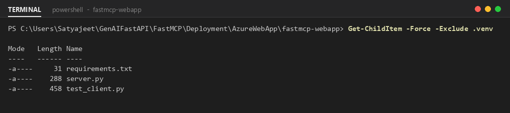

**requirements.txt**

```text
fastmcp==4.1.3
uvicorn==0.54.0
```

**server.py** – unchanged from the Container Apps guide. `host="0.0.0.0"` and `port=8000` matter: App Service forwards
traffic to port 8000 inside the app.

```python
from fastmcp import FastMCP

mcp = FastMCP("Azure MCP Server")


@mcp.tool
def add(a: int, b: int) -> int:
    """Add two numbers."""
    return a + b


if __name__ == "__main__":
    mcp.run(
        transport="http",
        host="0.0.0.0",
        port=8000,
        path="/mcp"
    )
```

**test_client.py** – a small client used to verify the server, locally and after deployment.

```python
import asyncio
import sys

from fastmcp import Client

URL = sys.argv[1] if len(sys.argv) > 1 else "http://localhost:8000/mcp"


async def main():
    async with Client(URL) as client:
        tools = await client.list_tools()
        print("Connected to:", URL)
        print("Tools available:", [tool.name for tool in tools])

        result = await client.call_tool("add", {"a": 5, "b": 7})
        print("add(5, 7) =", result.data)


asyncio.run(main())
```

## Step 2: Test locally in VS Code

Before touching Azure, prove the server works on your laptop. Open the VS Code terminal inside the project folder:

```powershell
python -m venv .venv
.\.venv\Scripts\Activate.ps1
pip install -r requirements.txt
```

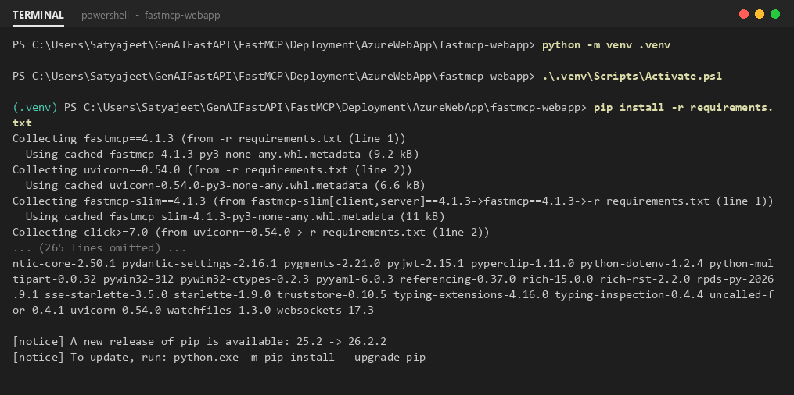

> If activation fails with *running scripts is disabled on this system*, run once:
> `Set-ExecutionPolicy -Scope CurrentUser RemoteSigned`

Start the server and keep this terminal running:

```powershell
python server.py
```

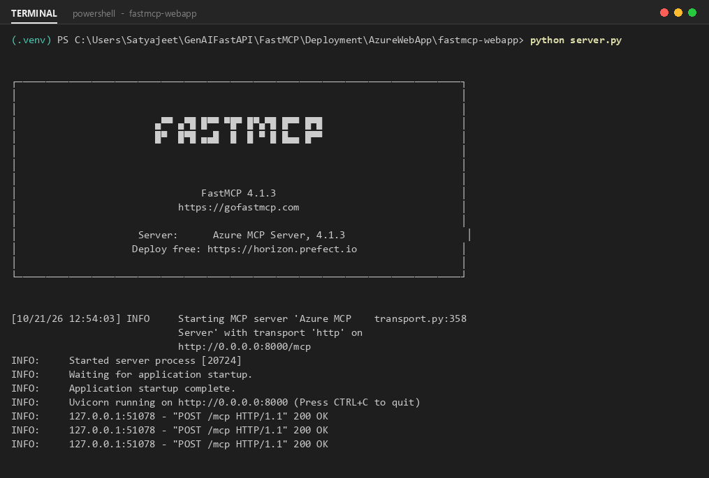

Open a **second** terminal (the **+** button in the terminal panel), activate the venv again and run the test client:

```powershell
.\.venv\Scripts\Activate.ps1
python test_client.py
```

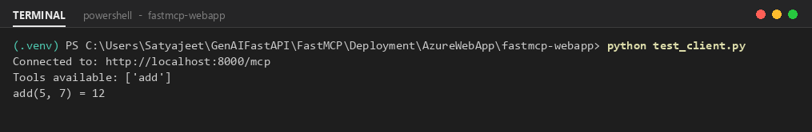

Stop the server with **Ctrl+C** before moving on.

## Step 3: Prepare Azure

```powershell
az login
az account show
az provider register --namespace Microsoft.Web
```

`az login` opens a browser to sign in; `az account show` confirms which subscription will be billed.

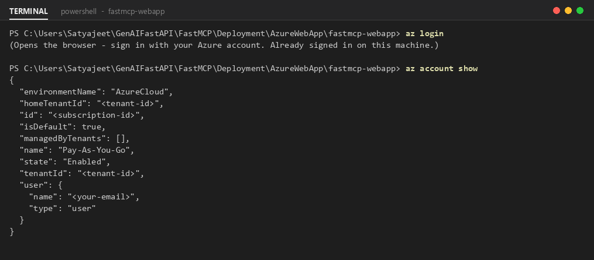

Register the App Service resource provider (one-time per subscription):

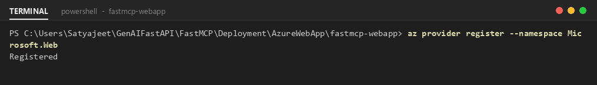

### Choose your names (do this once)

The web app name becomes part of a public URL, so it must be **unique across all of Azure**. Pick a short **suffix** of
your own (lowercase letters and digits, e.g. initials + a number) and store all names in PowerShell variables. Every
command below uses these variables, so you can copy them exactly.

```powershell
$SUFFIX = "ab12"                    # <- change to your own: lowercase letters/digits
$RG     = "fastmcp-webapp-rg"
$LOC    = "centralindia"
$PLAN   = "fastmcp-webapp-plan"
$APP    = "fastmcp-webapp-$SUFFIX"  # becomes https://<name>.azurewebsites.net
```

> Variables live only in the current terminal. If you close VS Code or open a new terminal, run this block again.
> The screenshots show the values used when this guide was made (suffix `8e5zs`).

## Step 4: Create a resource group

A resource group is a folder that holds every resource of this project, so you can see them together and delete them
together.

```powershell
az group create --name $RG --location $LOC
```

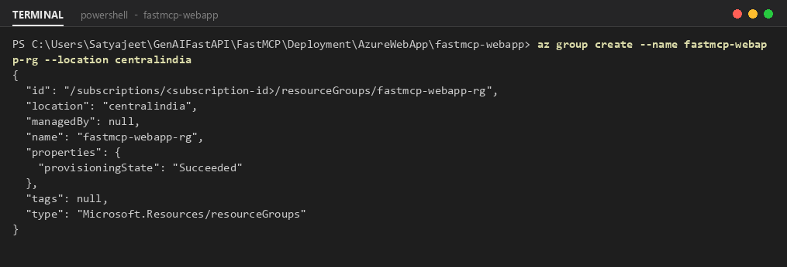

> **Region tip:** some subscriptions – especially **Azure for Students** – only allow certain regions. If a command
> fails with *RequestDisallowedByAzure*, *LocationNotAvailableForResourceType* or a policy error, set `$LOC` to another
> region and start again from Step 4. Regions with free Linux plans:
> `az appservice list-locations --sku F1 --linux-workers-enabled -o table`

## Step 5: Create an App Service plan

The **plan** is the machine your app runs on: operating system, size and price. `--is-linux` because Python apps run on
Linux; `--sku F1` is the **Free** tier.

```powershell
az appservice plan create --name $PLAN --resource-group $RG `
    --location $LOC --sku F1 --is-linux
```

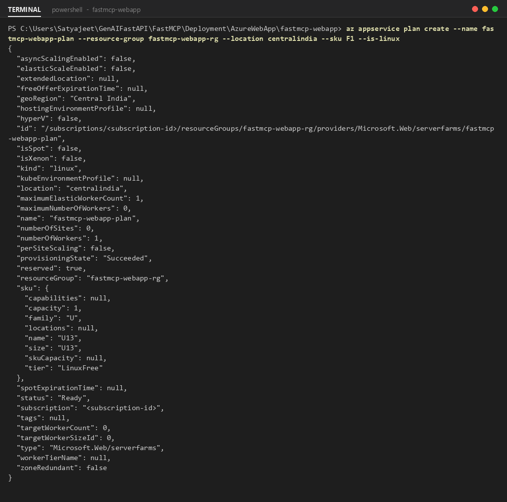

> **Free (F1) limits:** 60 CPU minutes per day, no *Always On* (the app sleeps after ~20 idle minutes and the next
> request takes a few seconds to wake it), and only **one free Linux plan per region per subscription**. Fine for a
> class; use **B1** (Basic) or higher for real use.

## Step 6: Create the web app

Creates the app on our plan with the Python 3.12 runtime. The **startup command** tells App Service to run our server
instead of looking for a Django/Flask app.

```powershell
az webapp create --name $APP --resource-group $RG --plan $PLAN `
    --runtime "PYTHON:3.12" --startup-file "python server.py"
```

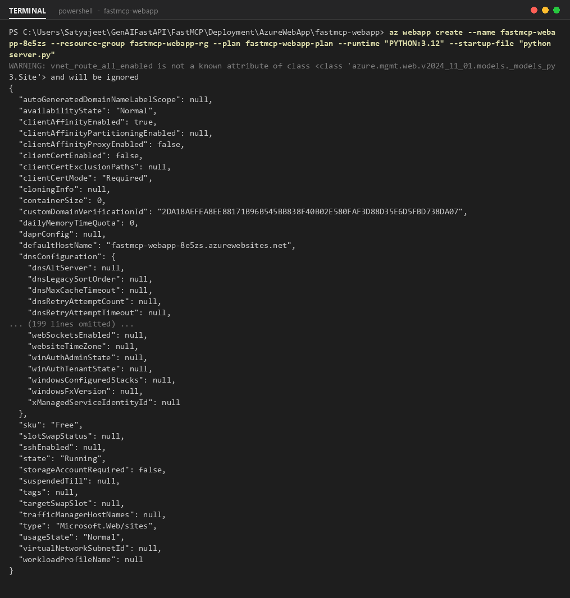

## Step 7: Configure app settings

- `SCM_DO_BUILD_DURING_DEPLOYMENT=true` – when we upload a zip, Azure runs `pip install -r requirements.txt` for us.
- `WEBSITES_PORT=8000` – send incoming traffic to port 8000, where `server.py` listens.

```powershell
az webapp config appsettings set --name $APP --resource-group $RG `
    --settings SCM_DO_BUILD_DURING_DEPLOYMENT=true WEBSITES_PORT=8000
```

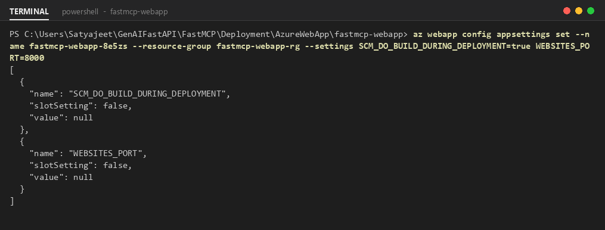

(The CLI hides setting values in its output – `"value": null` is normal.)

## Step 8: Package and deploy the code

Zip only the files the server needs and upload them. Azure installs the packages and starts the app with our startup
command. This takes 1–3 minutes.

```powershell
Compress-Archive -Path server.py, requirements.txt -DestinationPath app.zip -Force
az webapp deploy --name $APP --resource-group $RG --src-path app.zip --type zip
```

> Do **not** zip the `.venv` folder – it contains Windows packages that will not run on Linux.

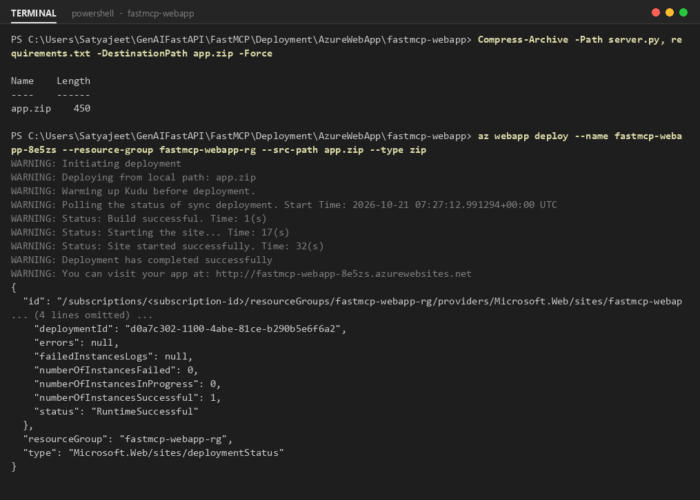

The output ends with `"status": "RuntimeSuccessful"`.

## Step 9: Get your MCP URL

Ask Azure for the hostname and build the MCP URL from it (stored in `$URL` for the next steps):

```powershell
az webapp show --name $APP --resource-group $RG --query defaultHostName -o tsv

$URL = "https://" + (az webapp show --name $APP --resource-group $RG --query defaultHostName -o tsv) + "/mcp"
$URL
```

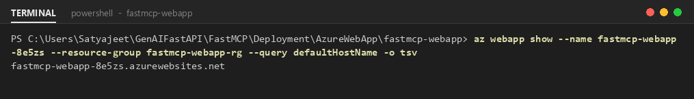

The endpoint is `https://` + hostname + `/mcp`, for example `https://fastmcp-webapp-8e5zs.azurewebsites.net/mcp`.

### In the Azure portal: see what was created

**portal.azure.com > Resource groups > fastmcp-webapp-rg** – just two resources: the App Service plan and the web app.

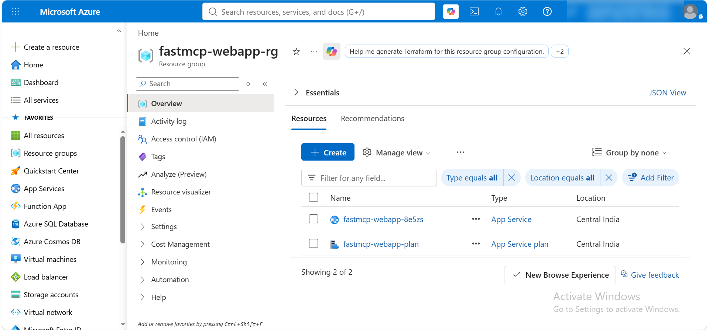

Web app > **Overview**: Status *Running*, App Service Plan *fastmcp-webapp-plan (F1)*, Operating System *Linux*, and
the **Default domain**.

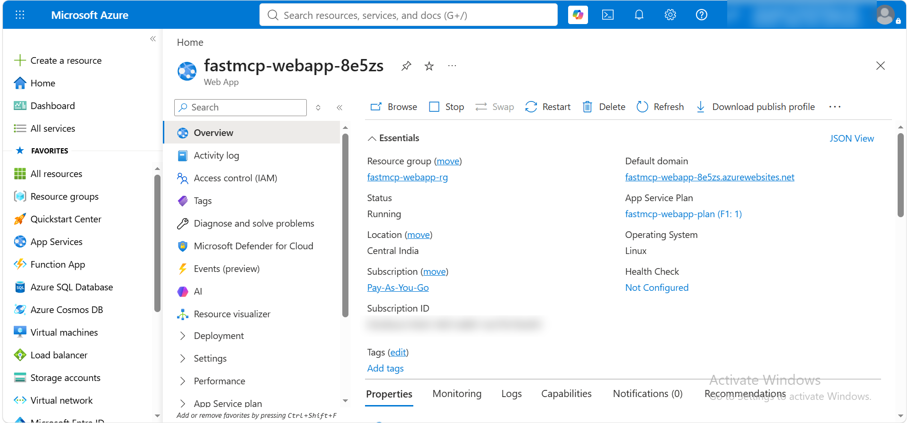

**Settings > Environment variables** shows the app settings from Step 7 (click *Show value*).

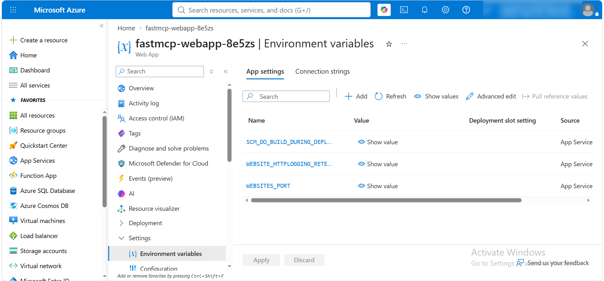

## Step 10: Watch the logs

Turn on container logging, then stream the logs. Run the test client in another terminal while it streams: you see the
FastMCP server start and the `POST /mcp ... 200 OK` requests. Press **Ctrl+C** to stop.

```powershell
az webapp log config --name $APP --resource-group $RG --docker-container-logging filesystem
az webapp log tail --name $APP --resource-group $RG
```

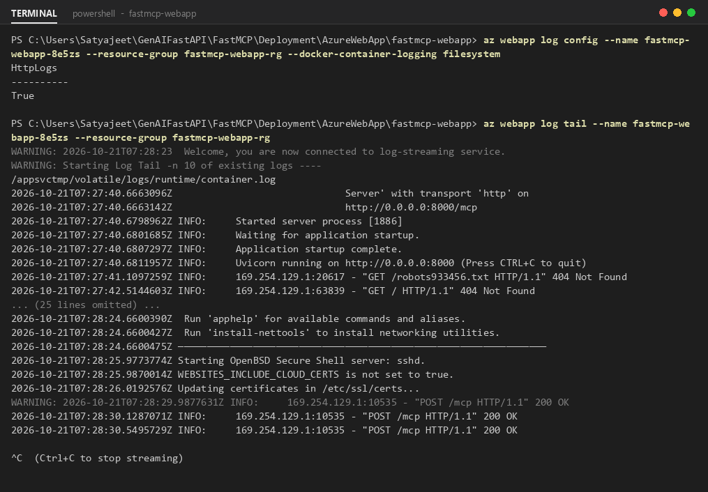

The portal shows the same stream under **Monitoring > Log stream**.

## Step 11: Test the deployed server and connect Microsoft Foundry

Run the same test client against the Azure URL (the venv must be active):

```powershell
python test_client.py $URL
```

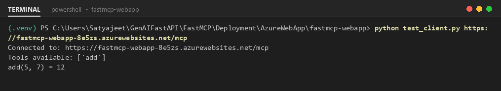

> **Cold start:** on the Free plan the app sleeps when idle, so the first call can take a few seconds. Call it once
> before class.

**Connect Microsoft Foundry** – in a Foundry agent add an MCP tool (**Tools > Add > Model Context Protocol**):

| Field | Value |
|---|---|
| Server URL | `https://<your-app>.azurewebsites.net/mcp` |
| Server label | e.g. `fastmcp-webapp` |
| Transport | Streamable HTTP |
| Authentication | None |

Try it: ask the agent *"Use the add tool to add 25 and 17"* – it should answer 42.

> **Security:** this demo endpoint is public with no authentication. Before exposing real business tools, add
> authentication (App Service built-in authentication with Microsoft Entra ID, or API Management).

## Step 12: Clean up

```powershell
az group delete --name $RG --yes --no-wait
```

Or in the portal: **Resource groups > fastmcp-webapp-rg > Delete resource group**. To re-deploy after editing
`server.py`, repeat only Step 8.

## Troubleshooting

| Symptom | Fix |
|---|---|
| `running scripts is disabled on this system` | `Set-ExecutionPolicy -Scope CurrentUser RemoteSigned` |
| Web app name *already exists* | Change `$SUFFIX` and run the names block again |
| Plan creation fails on F1 | Only one free Linux plan per region – reuse it, use another region, or `--sku B1` |
| Region / policy error | Use an allowed region (see Step 4) |
| Application Error page / app not starting | Check Step 10 logs; confirm startup command `python server.py` and `WEBSITES_PORT=8000` |
| `ModuleNotFoundError: fastmcp` in logs | `SCM_DO_BUILD_DURING_DEPLOYMENT=true` missing – set it (Step 7) and deploy again |
| `404 Not Found` | You used the base URL – add `/mcp` |
| Variables empty (`--name` missing) | New terminal – run the *Choose your names* block again |

## Files in this folder

| File | Purpose |
|---|---|
| `fastmcp-webapp/server.py` | The FastMCP server with the `add` tool |
| `fastmcp-webapp/requirements.txt` | Python dependencies (pinned versions) |
| `fastmcp-webapp/test_client.py` | Verifies the server locally and on Azure |
| `images/` | Screenshots used in this README |
